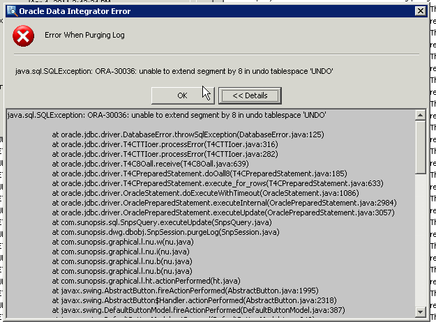
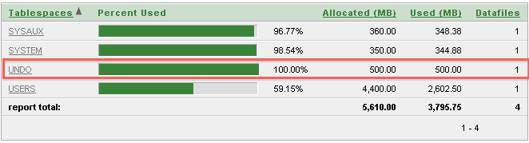

## Error when purging log unable to extend tablespace ‘UNDO’

[Oracle Data Integrator 10.1.3](http://www.oracle.com/technetwork/middleware/data-integrator/downloads/index.html) is a great tool and can even run fully functional against [Oracle Express](http://www.oracle.com/technetwork/database/express-edition/overview/index.html) which is the only free Oracle database product available.

## Problem

This limited database has it’s draw backs for production use. If Data Integrator is executing scenarios real time, or if the logs are never cleared it could quickly exceed the 5GB storage limit and this nasty error could show up.



```
Error When Purging Log

java.sql.SQLException: ORA-30036: unable to extend segment by 8 in undo tablespace 'UNDO'
```

Use Oracle APEX to find the maxed undo tablespace:



The problem is Oracle Express can’t extend the tablespace. Ultimately once the undo tablespace is full all reports need to be removed manually before a purge logs can be executed.


## Solution

Sometimes purging the logs from the command line will work but not from the Operator view:

`startcmd.bat OdiPurgeLog "-PURGE_REPORTS=1"`

Otherwise manually remove all reports and then purge using the command line or trash icon. Hint selecting multiple and right clicking ‘delete’ reduces the selection to one item. Instead select multiple and press delete key.


If this doesn’t work [delete the contents of the reports tables](http://www.business-intelligence-quotient.com/?tag=oracle-data-integrator-purge-log). I’d start with the  `SNP_EXP_TXT` table because this could have [50million+ records](http://odiexperts.com/tag/purge-logs).

---

### Significant Revisions

- Nov 17th, 2024 Copied down original files and updated layout
- May 6th, 2024 Converted to jekyll markdown format and copied to personal site
- Apr 11th, 2011 Originally published on [txcowboycoder wordpress site](https://txcowboycoder.wordpress.com/2011/04/11/error-when-purging-log-unable-to-extend-tablespace-undo/)[^draft]

### Footnotes

[^draft]: Initial `md` Generated using <https://github.com/jsr6720/wordpress-html-scraper-to-md>

    Original Wordpress categories: ['Oracle Data Integrator']

    Original Wordpress tags: "Oracle Data Integrator", "Data Integrator", "log purge error", "ODI", "oracle express", "ORA_30036"