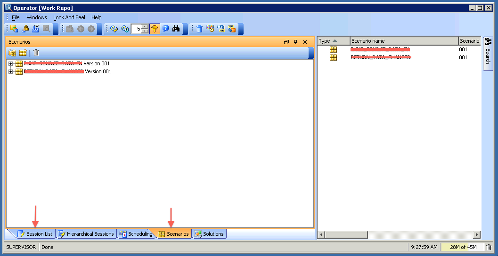

## Scenarios listed in Operator view are same as Designer view

I’m currently using Oracle Data Integrator (ODI) 10.1.3 and I went to clean out the logs generated by the completed executions. I know there is a purge logs trash can icon, but I couldn’t do this because the [‘UNDO’ tablespace was full](http://www.jsrowe.com/error-when-purging-log-unable-to-extend-tablespace-undo/index.html).

Since I was getting this error I had to remove the reports manually. Aside from removing the reports from the “Session List” tab I also went to remove them from the “Scenarios” tab. Thinking I would save time by removing the entire scenario’s worth of reports I deleted the root node (see image).

What I didn’t know is removing the generated scenario from the ODI Operator view would also remove it from the Designer view. All I had to do was go back and regenerate the scenario from Designer view, but if your installation had different scenarios for fall back purposes this could lead to trouble.

---

### Significant Revisions

- May 6th, 2024 Converted to jekyll markdown format and copied to personal site
- Apr 12th, 2011 Originally published on [txcowboycoder wordpress site](https://txcowboycoder.wordpress.com/2011/04/12/scenarios-listed-in-operator-view-are-same-as-designer-view/)[^draft]

### Footnotes

[^draft]: Initial `md` Generated using <https://github.com/jsr6720/wordpress-html-scraper-to-md>

    Original Wordpress categories: ['Oracle Data Integrator']

    Original Wordpress tags: "Oracle Data Integrator", "ODI", "Oracle Data Integrator", "Scenario"