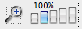

## Slider bar for zoom level

4Dv12 has a magnifying glass and preset zoom levels (50, 100, 200, 400, 800) to aid in designing forms. However, more fine tuned controls would aid in the design of complex and large forms.

Just a whimsical wish that I could zoom to something other than the presets. Even the magnifying glass doesn’t custom zoom, only zooms to the next or previous (with shift key) ‘level’ on the scale.

---

### Significant Revisions

- May 6th, 2024 Converted to jekyll markdown format and copied to personal site
- Apr 28th, 2011 Originally published on [txcowboycoder wordpress site](https://txcowboycoder.wordpress.com/2011/04/28/slider-bar-for-zoom-level/)[^draft]

### Footnotes

[^draft]: Initial `md` Generated using <https://github.com/jsr6720/wordpress-html-scraper-to-md>

    Original Wordpress categories: ['4D', 'Wish List']

    Original Wordpress tags: "4D", "Wish List", "magnify", "slider bar", "zoom"

