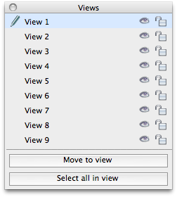
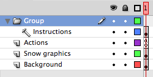
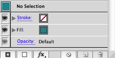

## 4D Forms to have layers instead of limited number of ‘views’

I would love it if 4D could mimic the dynamic layer system that Adobe uses.

### 4D Views

4D v11 has a limit of 9 ‘views’ per form. Views are great for swapping out elements in the same area and making it easier to target a collection of related objects.

With more complex forms, I’ve wanted more views than the maximum number allowed. I could use the pages feature of forms, but then I’d have to manage the current page programmatically. Besides views/layers are a design concept and pages are more to control data display.

The following are examples from Flash and InDesign. There are no conceivable limits to the number of layers in the Adobe suite. A small preview pane would be nice too, but lets not get ahead of ourselves.

### Adobe Layers

I’m a big fan of the color knock-outs that make it really easy to find that layer’s objects in the project.

### 4D forum feature request

Requires login, official feature request.  

[Adding views of our own.](http://forums.4d.fr/Post/EN/2637386/1/3153697#3153697)  

[Object has ‘layer’ property.](http://forums.4d.fr/Post/EN/2428886/1/3153714#3153714)

---

### Significant Revisions

- May 6th, 2024 Converted to jekyll markdown format and copied to personal site
- Apr 29th, 2011 Originally published on [txcowboycoder wordpress site](https://txcowboycoder.wordpress.com/2011/04/29/4d-forms-to-have-layers-instead-of-limited-number-of-views/)[^draft]

### Footnotes

[^draft]: Initial `md` Generated using <https://github.com/jsr6720/wordpress-html-scraper-to-md>

    Original Wordpress categories: ['4D', 'Wish List']

    Original Wordpress tags: "4D", "Wish List", "adobe layers", "flash layers", "layers", "views"

    Original Wordpress comments: <a href="https://txcowboycoder.wordpress.com/2011/04/29/4d-forms-to-have-layers-instead-of-limited-number-of-views/#comments">1 Comment</a>