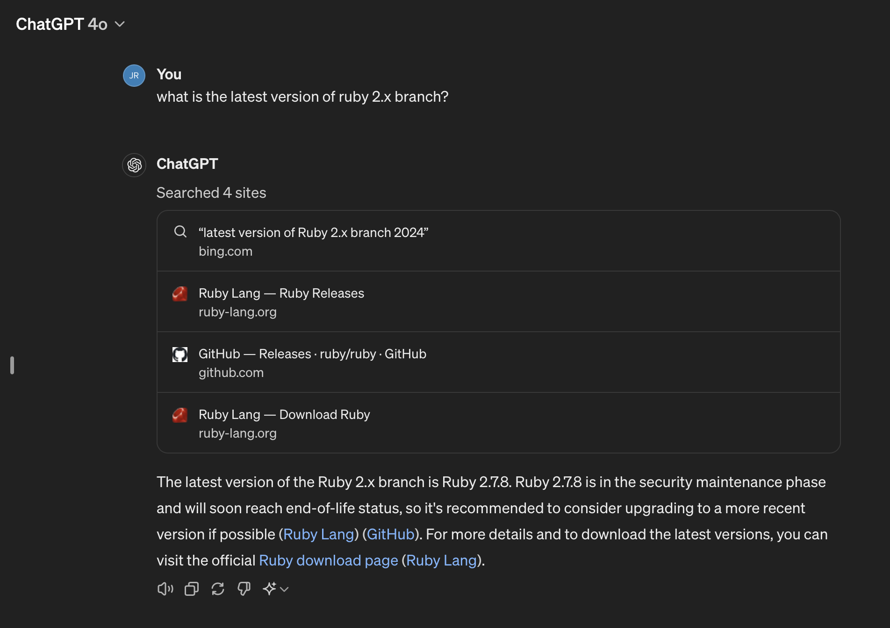
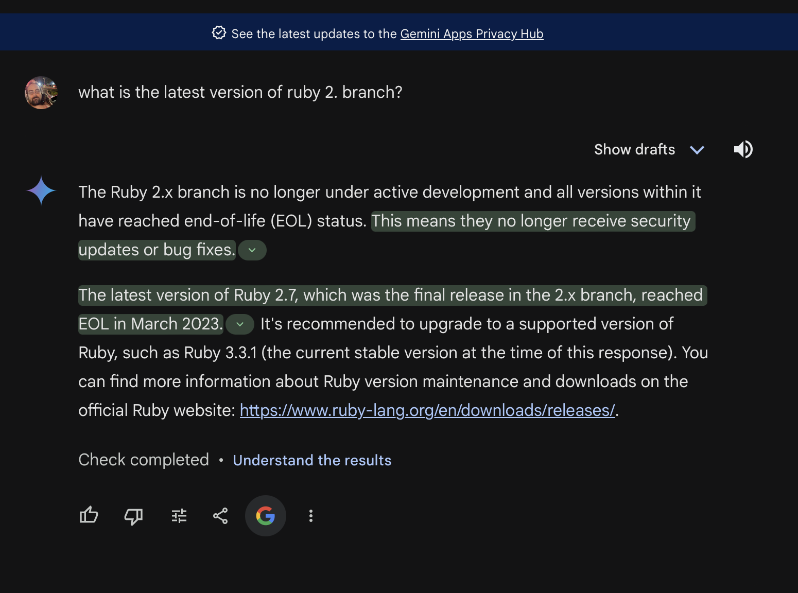
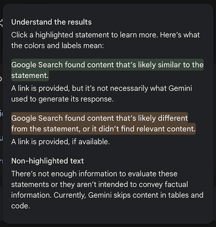

## ChatGPT-4o released today

My immediate impressions after spending a few hours with ChatGPT-v4o include speed improvements, result accuracy and finally **citations**! ChatGPT-v4o appears to have dramatic improvements in both time to response and time to render a full response.

I was able to get it to follow some online web links and parse larger PDF files than before. The launch video indicated there were UI improvements which I noted as inline feedback comments like `scanning document` or `searching sites`.

Over the past 6 months, I have been switching between v3.5 and v4 models depending on speed of response and perceived accuracy of results. To validate accuracy, as the disclaimers suggest, I've also spent time reviewing responses with traditional web searches and reading source materials.

## My thoughts yesterday

> Are the training sets going to be continuously updated? The biggest distinguishing mark from traditional search is the inclusion of publication dates from a variety of sites and publication sources.[^1]

Its hard to stress how astonished I was to have my wish granted for citations the next day after publishing [my thoughts on finding llm training data limits](/finding-llm-training-data-limits/). Since large language models generate responses based on patterns learned from vast amounts of data, it's important to verify the sources of the information they provide. Sadly, even with this version I was able to get ChatGPT-4o to hallucinate case law.

## Update on ruby 2.x.x latest version probe

### ChatGPT-4o `2.7.8`

Given the same question ChatGPT-4o indicated it searched four sites and returned a correct answer including the detail about it being a security branch.

> what is the latest version of ruby 2.x branch?

### Gemini Basic `2.7`

I realized in hindsight that Google I/O is ongoing and had released changes to Gemini which seem promising as well.[^subscription] Gemini did much better this time with identifying the `2.7` version but did not cite `2.7.8` even though it was able to cite `3.3.1` as latest minor version.

In reviewing these two examples I think ChatGPT-4o has the better UI experience for citations. Further I'm skeptical on Gemini's approach to highlighting content "double checked" with Google search. I also find ChatGPT naming of its model versions and switch-able nature of them better for comparison

---

### Significant Revisions

- May 15th, 2024 Originally published on [https://www.jsrowe.com](https://www.jsrowe.com) with uid F3A05744-A899-4349-AB7F-121CE6A970BE

### Footnotes

[^1]: [Finding llm training data limits](/finding-llm-training-data-limits/)

[^subscription]: I subscribe to `ChatGPT Pro` but I do not subscribe to `Gemini Advance`