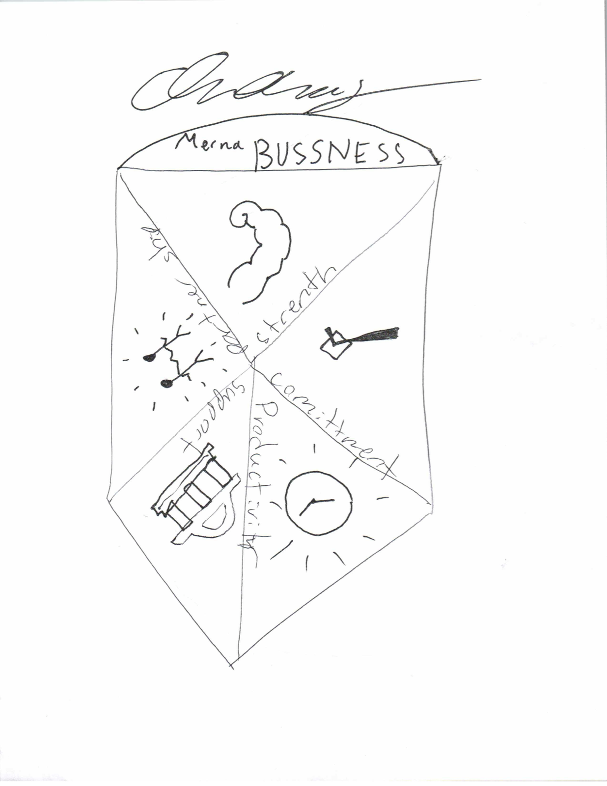

One of the benefits of working from home is that my children form impressions of what I do for work. Which evidently includes signing fancy documents with fancy logos. And isn't that worth preserving? I think Maddie was the representative owner of the team that day.

May I forever live up to the ideals of: Strength, Commitment, Productivity, Support and Partnership.

I'm convinced they drew inspiration from their [school's crest](/assets/posts-images/bcs1-crest-white.png).

The original scan is [here as a PDF](/assets/posts-images/rowe-children-company-trademark.pdf).

---

### Significant Revisions

- Nov 26th, 2026 Promoted from the `_whitepapers` README to `_posts`.
- May 23rd, 2024 Originally filed alongside my whitepapers with uid 67529DC1-EFBB-47CD-82A8-B11ADCC0DC0E. Ok, you caught me. Not really a whitepaper.
