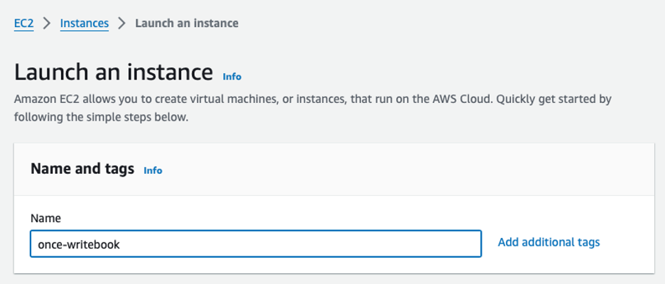
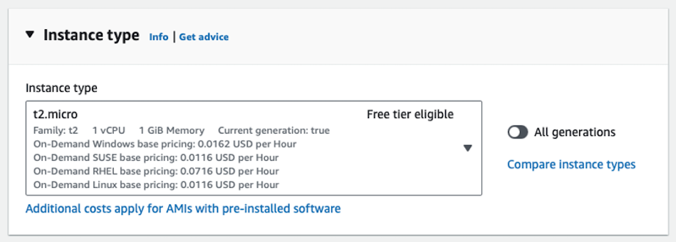
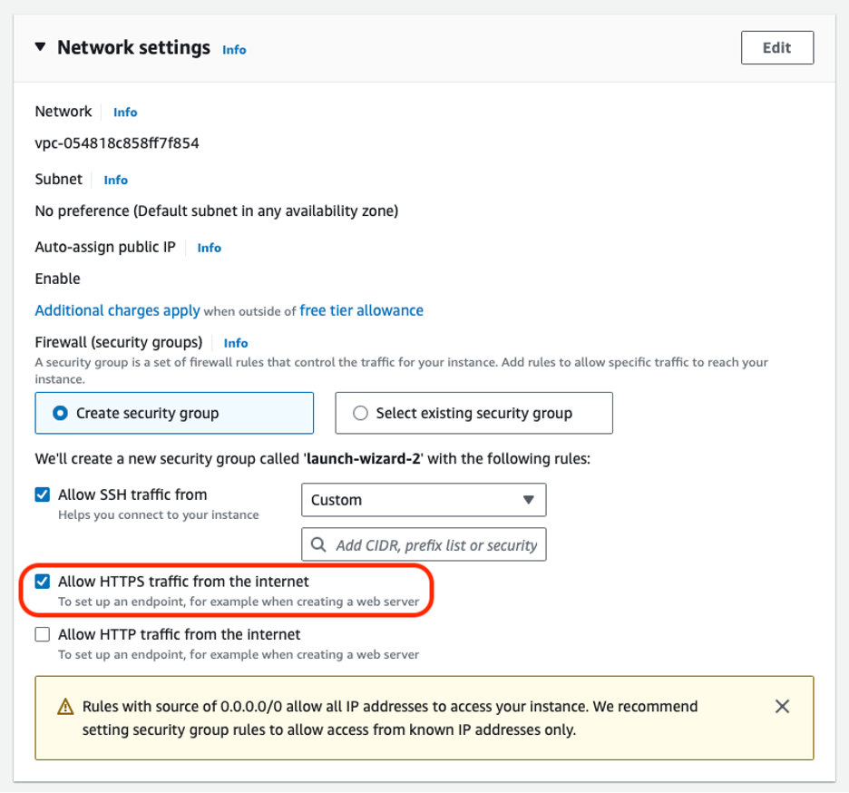
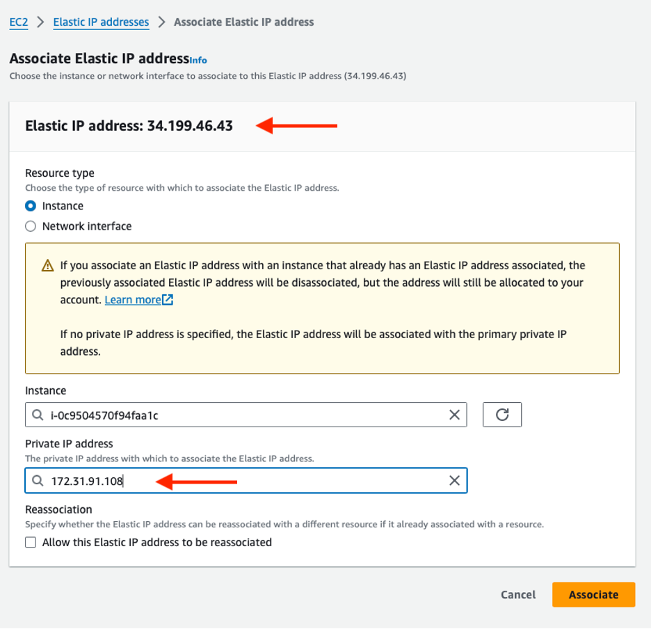
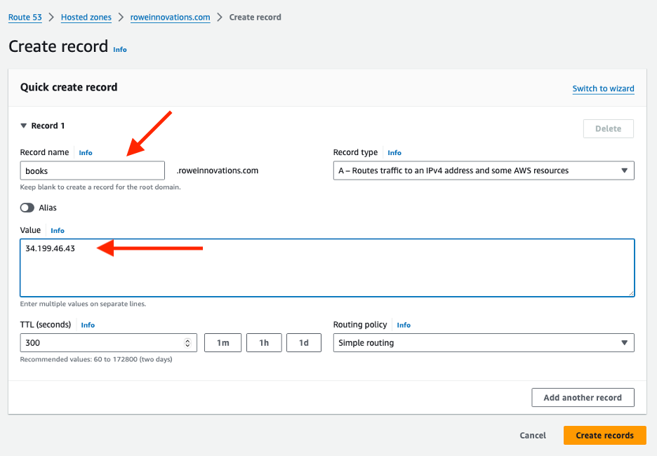
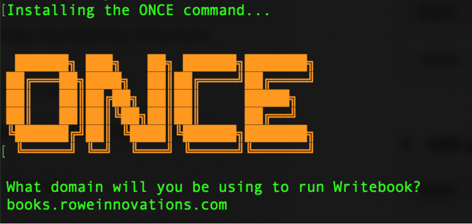
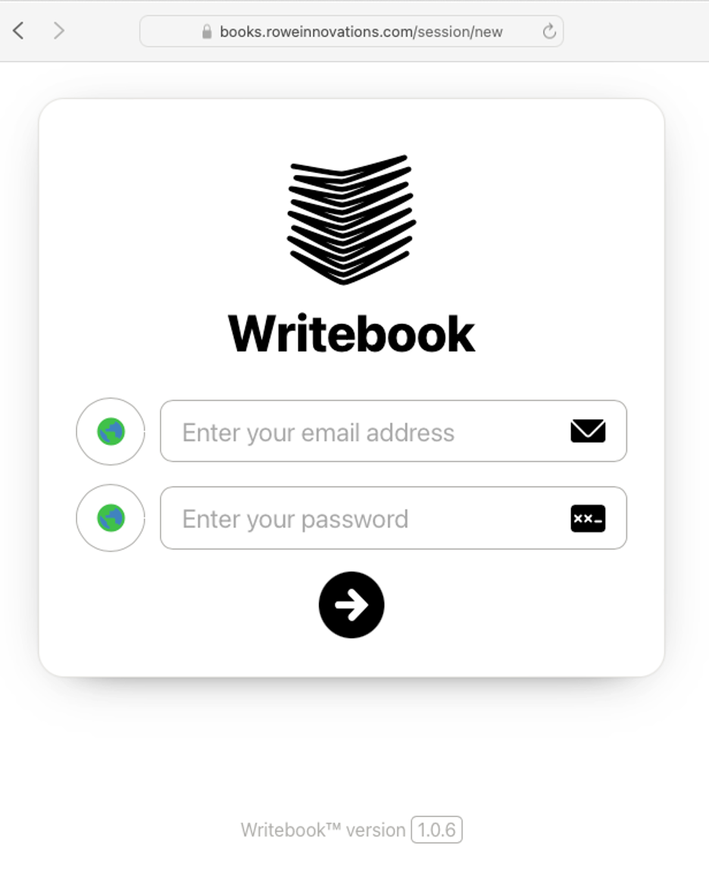
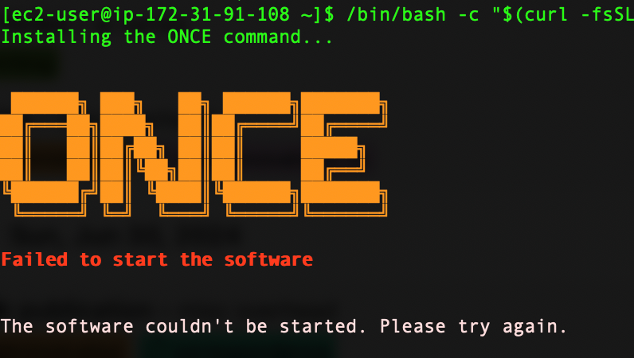

## 37signals Writebook by [once.com](https://once.com)

I wanted to try out a new free product that 37signals released called [Writebook](https://books.37signals.com). But their setup instructions didn’t include any steps for AWS. I respect this, but I use AWS for my personal software experimentation, so here’s how I got this working on my domain in three simple steps.

1. Configure and launch EC2 instance
2. Install docker and run Writebook setup script on the EC2 instance
3. Login to portal and setup application

## Disclaimer of Nonuse

I’m no longer running Writebook at `https://books.roweinnovations.com` because the features didn’t really fit what I was looking for, but it is an amazing piece of self-hosted software. It seems like a great product for hosting semi-dynamic content like employee handbooks or free literature. But I didn’t have anyone to collaborate with, and my primary means of written content distribution is this static site via Jekyll/GitHub.

## AWS Instance Setup

It's possible to setup Writebook with an existing domain if you have a little technical know-how. I did all of this with the AWS free tier.

## Launch an EC2 Instance

### 1. Create an EC2 instance and give it a name.

Make sure you check `Allow HTTPS traffic from the internet`.

For the purpose of exploring Writebook with my AWS free tier, I selected the `micro` instance type size. I recognize it is less than the recommended hardware requirements.







Accept the rest of the defaults and click Launch Instance at the bottom-right of the screen. It will take just a few minutes for your server to be created.

### 2. Create an Elastic IP address and associate it to the now running EC2 instance. This IP will be used in the DNS record.



### 3. Create a simple DNS record in Route 53 that points your domain to the EC2 instance via the associated Elastic IP address.



## Install Writebook on the EC2 Instance

### 1. SSH into the EC2 instance and install docker.

```bash
% ssh -i "once-writebook-key-pair.pem" ec2-user@<ec2-instance>.compute-1.amazonaws.com
sudo yum install docker -y
sudo service docker start
sudo usermod -a -G docker ec2-user
```

### 2. Run the Bash script with your unique key sent to your email from once.com.

```bash
/bin/bash -c "$(curl -fsSL https://auth.once.com/install/<install-key>)"
```

### 3. Input your domain when prompted.



You're done! Open the URL in your web browser and set up your Writebook account.



## Troubleshooting

I only encountered two errors when installing, but the log file I found was terse and there was no troubleshooting section in the online manual. I was able to trial everything else with the site, so I’m not really sure what happened.



After that error message I found an error file at the root directory but it wasn’t helpful.
 
```console
[ec2-user@ip-172-31-91-108 ~]$ cat .once-error.log 
2024/07/06 16:58:55 exit status 1
2024/07/06 17:02:15 Get https://books.roweinnovations.com/up: remote error: tls: internal error
```

I was able to load the above URL. So I checked Docker, which indicated the instance was running.

```console
[ec2-user@ip-172-31-91-108 ~]$ docker ps
CONTAINER ID   IMAGE                         COMMAND                  CREATED          STATUS          PORTS                                      NAMES
58897f34c382   registry.once.com/writebook   "/rails/bin/docker-e…"   39 minutes ago   Up 39 minutes   0.0.0.0:80->80/tcp, 0.0.0.0:443->443/tcp   writebook 
```
 
After I confirmed the instance was running, I loaded the configured URL (`https://books.roweinnovations.com`) and was able to create a user.

The other problem I noticed was that I didn’t get all of the “once” commands listed in the documentation. I only saw “help” and “setup”; the online docs indicate there should be more. Again, since I was able to try it out and abandon it, I didn’t look much further into this.

```console
[ec2-user@ip-172-31-91-108 ~]$ once
Install and manage ONCE products

Usage:
  once [command]

Available Commands:
  help        Help about any command
  setup       Perform the initial setup
```

---

## Postscript

Most of this troubleshooting and setup was done in July but I'm just now getting around to publishing this in September. Since I installed Writebook in the first week of its release, I had to install this with RTFM as my mantra. Incidentally, `once.com` uses the Writebook product itself to host the manual.

### Significant Revisions

- Sep 12th, 2024 Originally published on [https://www.jsrowe.com](https://www.jsrowe.com) with uid A177F24A-4C7A-448A-A293-260C7171B369
- Jul 7th, 2024 Draft and original setup attempted as a weekend project.