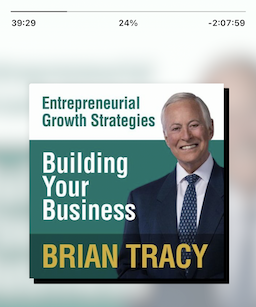

Brian Tracy, *Building Your Business: Entrepreneurial Growth Strategies*, Ascent Audio 2016 (audiobook)

[https://share.libbyapp.com/title/2906125](https://share.libbyapp.com/title/2906125)

## My Review 1/5

Disclaimer: I did not finish this work. In fact, you could have convinced me this was published in the early 2000s—the dated references to Yahoo, Kmart, and direct mail all turned me off. Only upon writing this review did I discover it was actually published in 2016! I picked this familiar author to try out `Libby`[^libby] on my phone. I’ve been very happy with his other works such as *[Eat That Frog](/eat-that-frog/)* and *[Management](/management/)*, but this time I was left disappointed.

Production quality is poor—it almost sounds like Brian Tracy was winging it in the recording booth, revising his anecdotes as he went along. I also discovered that this is *not* an ISBN published book but a seminar-style recording. Hard pass.

---

### Significant Revisions

- Nov 1st, 2024 Originally published on [https://www.jsrowe.com](https://www.jsrowe.com) with uid FE8FD2C6-DE9F-4CCE-A05A-7FDEDEA7D9BD

### Footnotes

[^libby]: When I was commuting to work in-office, I had roughly 90 minutes to devote to daily listening of audiobooks on CD from my local library. Since I've been working remotely, my consumption of books has dropped precipitously, but I recently decided to give OverDrive another shot—and learned it is now [Libby](https://libbyapp.com).
