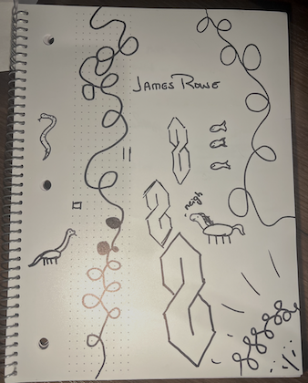
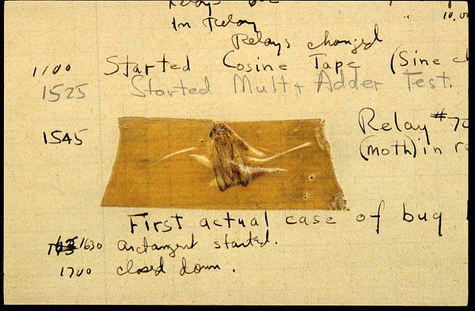
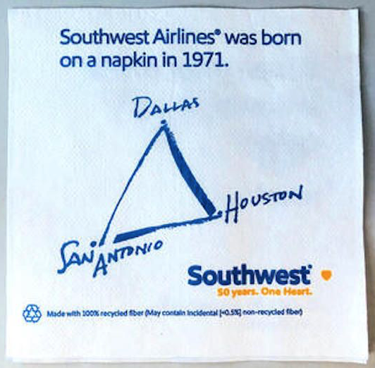

> **Note:** Originally a sub section on [Journaling, Why Write?](/journaling-why-write/) that I’ve moved to its own post.

<figure>
    
    <figcaption>
        One of my notebooks. <cite>Rowe Children Adorned</cite>
    </figcaption>
</figure>

## Famous Journal Entries

When I think about my writings, I think about famous journals that have persisted through time.

### The First Computer "Bug"

<figure>
    
    <figcaption>
        First actual case of a computer bug. <cite>American History Collections</cite>
    </figcaption>
</figure>

Downloaded from <https://americanhistory.si.edu/collections/nmah_334663> with companion [meta-data](/assets/posts-images/file_metadata_NMAH-NMAH2000-03035_info.txt).[^guid]

### Copper Complaint

Considered the oldest ‘customer complaint’ known.[^verizon]

<https://en.wikipedia.org/wiki/Complaint_tablet_to_Ea-nāṣir>

<https://web.archive.org/web/20240418012802/https://www.nationalgeographic.com/history/article/ea-nasir-copper-merchant-ur>

### The Light Has Gone Out—Roosevelt

A more somber entry. But what a tremendous weight a single X on a page represents.

*Theodore Roosevelt's diary, February 14, 1884. Public domain, via [Wikimedia Commons](https://commons.wikimedia.org/wiki/File:Light_has_gone_out.jpg).*

### The Birth of an Airline

Just a simple napkin and an idea.

### Memoirs and Diaries

*Diary of Anne Frank* maybe being the most famous. *[Ernest Shackleton's Diary of the Quest Expedition, 1921-22](https://www.spri.cam.ac.uk/archives/shackleton/articles/1537,3,9.html)* another.

[John and Abigail Adams](https://www.masshist.org/digitaladams/archive/letter/) letters come to mind.

### Family Roots

So many of the artifacts shown on *[Family Roots](https://www.pbs.org/show/finding-your-roots/)* include written document, newspapers and other announcements.

---

### Significant Revisions

- Feb 19th, 2025 Published on [https://www.jsrowe.com](https://www.jsrowe.com) with uid C518ED2F-8F63-4289-9AFD-0D9CD80EC2A1

### Footnotes

[^guid]: <https://americanhistory.si.edu> gets it. I see you, Director Howard Hathaway Aiken. I had wondered if I was silly to include a guid in my files. I wonder no more.

[^verizon]: I can only laugh because I archived my own [Verizon Complaint](/_archive/2011-01-09-verizon-restocking-fee-is-not-a-penalty.md).
